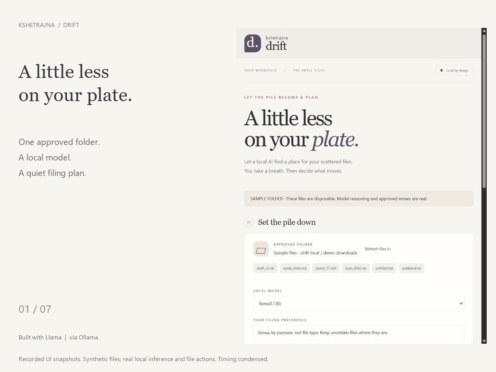

# Kshetrajna Drift

**A little less on your plate.** A new, small local AI companion that turns a pile of loose files into an explained filing plan, then performs only the moves you select and approve.



Built with Llama, served locally through Ollama. The demo uses **Llama 3.1 8B Q4_K_M**; weights are not bundled. Other installed local models can be selected. The application code is MIT licensed. Llama is **open-weight under Meta's Llama 3.1 Community License**, not claimed to be OSI open source.

## What works

- A local model classifies files by purpose into Study, Work, Receipts, Personal, Read Later, or Keep here and explains its choice.
- A plain-language filing preference affects the model prompt. Categories are fixed in this prototype.
- Preview first, no files preselected, one explicit approval for selected moves.
- Content excerpts are optional: up to 600 bytes from each `.txt`, `.md`, or `.csv`. Real folders default to filenames and sizes only; sample mode enables excerpts.
- SHA-256, file identity, size and modification time are rechecked before approval executes.
- A local SQLite journal records intent before moving. Undo and startup recovery handle the documented interruption states.
- A quiet responsive dashboard, plan export, visible history, single-use approvals expiring after ten minutes.
- No cloud API key, telemetry SDK, web font, CDN, or Python package dependency.

## Start in about a minute (once prerequisites are installed)

Requires **Python 3.12+** and [Ollama](https://ollama.com/download). Verified here with Python 3.13.3, Ollama 0.11.10 and an already-installed `llama3.1:8b` model on Windows. A first model download needs internet and several GB of disk space/RAM; inference speed depends on your hardware.

Start Ollama. Install an open-weight model if needed:

```sh
ollama pull llama3.1:8b
```

Then double-click **Launch.cmd** on Windows, or run:

```sh
python app.py --demo
```

Open **http://127.0.0.1:8778** if your browser does not open automatically. The demo copies six synthetic sample files into `.drift-local/demo-downloads`; inference, approved moves and undo are real. It does not inspect your personal Downloads folder.

To approve a real folder instead, stop the demo with Ctrl+C and run, in PowerShell:

```powershell
python app.py --folder "$env:USERPROFILE\Downloads"
```

Or on another platform:

```sh
python app.py --folder /absolute/path/to/a/folder
```

Only loose files in that folder are scanned. Turn on text previews only if you want those supported contents sent to your local Ollama runtime. The app does not OCR images or extract PDFs/Office files. Those formats are classified from filenames and sizes only.

Use **Make a quiet plan**, review each reason, tick individual files, then choose **Approve selected moves**. Files keep their names and move beneath `_Drift/<category>` inside the approved folder. **Undo** restores an unchanged file when its original name is unoccupied. Stopping the dashboard does not stop an independently running Ollama service; each model request asks Ollama to unload after one idle minute.

## Measured demo, not a productivity claim

The first real inference took **17.56 seconds** for six synthetic files. Its five category choices plus one Keep-here decision matched the fixture's intended purposes. The receipt was moved and restored through the browser UI, and its contents matched the original fixture afterward.

That is one fixture, not a general accuracy score or measured time saving. See [the raw sanitized inference record](evidence/local-inference.json), [test output](evidence/test-results.txt), and [demo guide](DEMO.md).

## Why the open pieces matter

The model does the semantic filing work. Without a model, the app returns an error and moves nothing; there is no rule-based classifier pretending to be AI. A `.txt` receipt, `.txt` client brief and `.txt` picnic note can land in different places because the model interprets their purpose.

After installing the runtime and weights, the same workflow can operate offline. This build's inference was verified over loopback; a disconnected-network run has not been measured. You control the weights, runtime, categories, prompt and executor. No hosted per-request model bill is involved; hardware, storage and electricity still have costs.

## Architecture

```mermaid
flowchart LR
    A[Approved folder] --> B[Bounded scan and file snapshots]
    B --> C[Optional short text excerpts]
    C --> D[Ollama on 127.0.0.1:11434]
    D --> E[Open-weight Llama 3.1 8B]
    E --> F[Strict ID and category validation]
    F --> G[Explainable plan in local dashboard]
    G --> H[User selects and approves]
    H --> I[Revalidate files and destinations]
    I --> J[Journal intent in SQLite]
    J --> K[No-overwrite link then unlink]
    K --> L[History, undo and restart recovery]
```



`drift.py` owns scanning, model requests, validation and the file executor. `app.py` serves only fixed local assets and authenticated local APIs. `static/` is dependency-free HTML/CSS/JavaScript. A background model job keeps status polling responsive.

Ollama's [structured-output API](https://docs.ollama.com/capabilities/structured-outputs) supplies a JSON schema. Drift independently rejects invented/duplicate/missing IDs, unknown categories, extra fields and invalid reasons. The model never supplies executable paths, shell commands or tools. Prompt instructions are defense in depth; deterministic constraints and approval are the execution boundary.

## Boundaries and recovery

- Prototype: maximum 12 files per batch, each at most 50 MiB. Hidden entries, subfolders, partial download extensions and files modified in the last two seconds are excluded. Two seconds is a heuristic, not a guarantee that a download is finished; later changes invalidate approval.
- Requires a filesystem supporting **same-volume hard links** (for example NTFS). It fails without deleting the source if hard-link creation is unsupported; there is no copy/delete fallback. Cross-volume movement is not supported.
- Each file uses atomic no-overwrite destination creation, then source unlink. The selected batch is **not an atomic transaction**: earlier successful moves remain in history if a later move fails.
- `prepared` and `undoing` journal rows are recovered at startup or with **Check recovery**. If both names reference the same unchanged inode, the interrupted operation rolls back. A completed unlink is recognized from the remaining file and hash. Conflicting/changed paths stay unresolved for inspection; the app does not overwrite either.
- Undo is conditional, not universal. Modified files or occupied original paths block it. Empty category folders are left behind. No content is renamed, rewritten, archived or permanently deleted as a cleanup feature.
- Links and junctions are rejected. Path checks are repeated, but the prototype does not isolate against hostile programs running as the same OS user, which can race file operations or alter the database. Do not treat it as a sandbox for untrusted local processes.
- Loopback binding, exact Host checks, per-launch token, matching Origin on writes, fixed static paths and a restrictive content policy protect ordinary browser access. Do not expose it through a public tunnel.
- `.drift-local/journal.sqlite3` persists absolute approved roots, relative filenames, hashes and move status in plain SQLite. Plans and excerpts are in process memory; exported plans include the folder path and excerpts. Review exports before sharing. Ollama has its own runtime/storage policies. There is no application encryption or automatic journal retention policy. Keep the journal while moves need undo.

## Test

```sh
python -m unittest discover -s tests -v
```

**31 tests passed on Windows**, including a real hard-link/undo roundtrip, changed files, destination conflicts, interrupted move/undo recovery, model failure, output validation and local HTTP access checks. Model-unit tests use explicit test doubles; the separate inference evidence is an actual Llama run. Other operating systems are not yet qualified.

An optional GitHub Actions test matrix is supplied as `docs/test-workflow.yml`. It is a template, not an active workflow: the publishing connection does not have workflow-management scope. Local test evidence above is independent of CI.

## New work and attribution

Created on **October 25, 2026** for [Hacktoberfest Open-Source AI Challenge Week 3: Slow and Steady](https://dev.to/challenges/hacktoberfest-week3-2026-10-19). This is a **new standalone application and repository**, inspired by our earlier [Kshetrajna](https://github.com/Team-SankatMochan/KSHETRAJNA-OS) project. It does not present that older application as new work. No source files or model weights were copied from that repository; the Observe → Explain → Approve → Act → Recover approach and branding are credited to it.

New here: the compulsory semantic file-planning pipeline, bounded schema/ID-only decisions, independent executor/recovery journal, dashboard, fixtures and tests. This was built with AI coding assistance. This attribution documents provenance; organizers determine eligibility.

Third-party components remain under their own terms: [Ollama (MIT)](https://github.com/ollama/ollama/blob/main/LICENSE), [Llama 3.1 model license](https://github.com/meta-llama/llama-models/blob/main/models/llama3_1/LICENSE). No partner prize category is claimed solely because a tool is installed.

If commits are made after the challenge's submission deadline, record them here before submitting or updating the entry. None are being represented as pre-deadline work retroactively.
